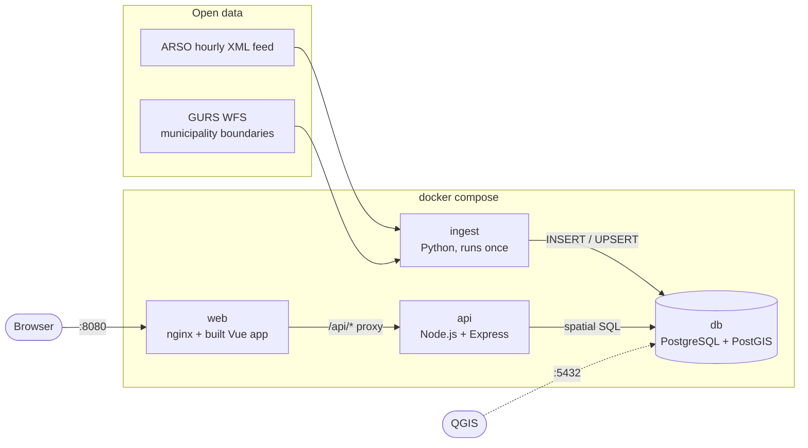

# Slovenia Air Quality GIS


A web GIS application that shows Slovenia's air-quality monitoring stations and its
212 municipalities on an interactive map. It loads hourly measurements from ARSO, the
Slovenian Environment Agency, into PostGIS. A Node.js API answers spatial questions
with SQL and returns GeoJSON, and a Vue + Leaflet frontend draws the results.

This is a web rebuild of an older desktop project of mine, a Java/LibGDX weather and
air-quality map of Slovenia.

<!-- TODO: add screenshot or GIF -->


**What you can do**

- See every municipality coloured by the latest hourly PM10 value of its nearest station
  (European Air Quality Index bands).
- Click anywhere to see which municipality you clicked and the 3 nearest stations, with
  distances and lines drawn to them.
- Click a station to see its latest PM10, PM2.5, O₃ and NO₂ values and a 7-day chart.

**Stack:** PostgreSQL 17 + PostGIS 3.5 · Python 3.12 (ingestion) · Node.js 24 + Express 5
with `pg` and raw SQL · Vue 3 + Vite + Leaflet · Docker Compose · GitHub Actions

## Architecture



Startup order is enforced with healthchecks: `db` becomes healthy, then `ingest` loads
the data and exits with code 0, then `api` starts and becomes healthy, then `web` starts.

```
db/init/          SQL schema and views (run automatically on first DB start)
ingest/           Python ingestion + pytest tests
api/              Express API, src/routes/*.js hold all SQL + Vitest tests
web/              Vue 3 + Leaflet frontend, nginx config
data/sample/      Committed offline snapshot (labeled, see its README)
```

## Running it

Requirements: Docker with Docker Compose.

```bash
docker compose up --build
```

Open <http://localhost:8080>. The API is also available directly at <http://localhost:3000/api/stations>.

- Each `docker compose up` runs the ingestion again, which adds any new hours (the feed
  updates hourly at about :45). To refresh while the stack is running:
  `docker compose run --rm ingest`.
- Without internet access, or with `INGEST_OFFLINE=1`, ingestion loads the committed
  sample snapshot instead. The UI then shows an "Offline sample snapshot" badge.
- Default settings work out of the box. To change ports or credentials, copy
  `.env.example` to `.env`.
- The schema in `db/init/` only runs on an empty database volume. After changing it,
  run `docker compose down -v` to recreate the database.

## API

All spatial endpoints return GeoJSON. Invalid parameters return `400` with
`{"error": "..."}`.

| Endpoint | Description |
|---|---|
| `GET /api/stations` | All stations, each with its latest PM10, PM2.5, O₃ and NO₂ readings |
| `GET /api/stations/nearest?lat=&lng=&limit=3` | Nearest stations to a point, with `distance_km` (limit 1–50) |
| `GET /api/stations/within?lat=&lng=&radius_km=` | Stations within a radius (0.001–500 km) |
| `GET /api/stations/:code/history?pollutant=&hours=168` | Hourly time series (a Feature with `series` in its properties) |
| `GET /api/municipalities` | Simplified boundaries + PM10 of the nearest station with a current value |
| `GET /api/municipalities/at?lat=&lng=` | The municipality that contains the point (empty if outside Slovenia) |
| `GET /api/health` | Status and info about the last ingestion run |

Example: `curl "http://localhost:3000/api/stations/nearest?lat=46.0514&lng=14.506"`

## Spatial queries and why

The full queries are in [`api/src/routes/`](api/src/routes). Here are the key parts.
[LEARNING.md](LEARNING.md) explains the concepts in plain language.

**Nearest stations (KNN):**
```sql
ORDER BY s.geom::geography <-> ST_SetSRID(ST_MakePoint($1, $2), 4326)::geography
LIMIT $3
```
`<->` combined with `ORDER BY … LIMIT` makes PostGIS walk the GIST index from the
nearest entry outwards and stop after `limit` rows. Ordering by `geography` gives
the true distance on the Earth's surface. At Slovenia's latitude a degree of longitude
is only ~70% as long as a degree of latitude, so ordering by raw degrees could return
stations in the wrong order. A GIST index on the expression `(geom::geography)` makes
this indexed. `EXPLAIN` shows `Index Scan using stations_geog_idx … Order By: …`.

**Stations within a radius:**
```sql
WHERE ST_DWithin(s.geom::geography, <point>::geography, $3)   -- $3 in metres
```
`ST_DWithin` first does a fast index-based bounding-box check, then an exact distance
check. This is faster than `ST_Distance(...) < r`, which can't use an index.

**Which municipality contains a point:**
```sql
WHERE ST_Contains(geom, ST_SetSRID(ST_MakePoint($1, $2), 4326))
```
The GIST index finds the few polygons whose bounding box contains the point, and
`ST_Contains` does the exact point-in-polygon test only on those.

**Municipalities with an air-quality value:**
```sql
ST_AsGeoJSON(ST_Multi(ST_SimplifyPreserveTopology(m.geom, 0.001)), 5)
...
LEFT JOIN LATERAL (
    SELECT ... FROM stations s JOIN latest_readings r ON ... AND r.pollutant = 'pm10'
    ORDER BY s.geom::geography <-> ST_PointOnSurface(m.geom)::geography
    LIMIT 1
) nearest ON true
```
- **Simplification.** The full GURS boundaries are 39 MB of GeoJSON. Simplifying with a
  tolerance of about 100 m and rounding coordinates to 5 decimals (about 1 m) brings the
  response down to ~480 KB, or ~170 KB with nginx's gzip.
  `ST_SimplifyPreserveTopology` never produces invalid or self-intersecting polygons.
- **Nearest station instead of average.** Only ~20 of the 212 municipalities contain a
  station, so "average of stations inside" would leave most of the map blank. Each
  municipality instead gets the value of the nearest station with a PM10 reading from the
  last 6 hours. The panel shows which station that is and how far away.
- **Point on surface.** `ST_PointOnSurface` is used rather than the centroid because a
  centroid can fall outside a concave polygon.

**Latest reading per station:** this is a view in [`db/init/03_views.sql`](db/init/03_views.sql)
that uses `DISTINCT ON (station_code, pollutant) … ORDER BY …, measured_at DESC`, served
by the primary-key index.

## Data sources and licenses

| Data | Source | License |
|---|---|---|
| Hourly air-quality measurements and station locations | ARSO – Agencija RS za okolje, XML feed [`ones_zrak_urni_podatki_7dni.xml`](https://www.arso.gov.si/xml/zrak/ones_zrak_urni_podatki_7dni.xml) ([feed overview](https://www.arso.gov.si/zrak/kakovost%20zraka/podatki/kakovost_zraka_xml.html)) | Listed on the national open data portal [podatki.gov.si](https://podatki.gov.si/dataset/podatki-o-kakovosti-zunanjega-zraka-in-padavin-pm10-o3-so2-co-nox-voc-sestava-delcev-kakovost-padavi), whose terms allow reuse with attribution (CC BY 4.0). Source: ARSO. |
| Municipality boundaries (212 občine) | GURS – Geodetska uprava RS, register of spatial units, public WFS layer `SI.GURS.RPE:OB_G` | [CC BY 4.0](https://creativecommons.org/licenses/by/4.0/), © GURS |
| Base map | © OpenStreetMap contributors | ODbL |
| PM10 colour bands | [EEA European Air Quality Index](https://airindex.eea.europa.eu/AQI/index.html) (revised, hourly) | — |

ARSO marks its real-time data as **unverified and for information only**. The ARSO
dataset entry on the portal has no license field filled in, so the attribution above
follows the portal's general open-data terms.

No measurement values are invented. Values the feed reports as below the detection limit
(for example `<2`) are stored as the limit with a `below_limit` flag and displayed as `<2`.
Missing values are left out.

## Tests

API tests (Vitest + supertest) run against a separate, throwaway PostGIS database loaded
with the committed sample snapshot, so the expected values are deterministic:

```bash
docker compose --profile test run --rm --build api-test
docker compose --profile test down
```

They cover:
- every spatial endpoint;
- distances checked against an independent haversine calculation;
- KNN order checked against true distance order;
- `within` agreeing with `nearest`;
- point-in-municipality, including a point outside Slovenia;
- GeoJSON structure and the payload size limit;
- every validation 400.

Python tests (pytest) cover XML parsing, time-zone conversion (CET and CEST),
below-limit and missing values, and GeoJSON parsing:

```bash
cd ingest
pip install -r requirements-dev.txt
pytest
```

Lint: `ruff check .` (ingest) and `npm run lint` (api, web). GitHub Actions runs all of
this on every push ([`.github/workflows/ci.yml`](.github/workflows/ci.yml)).

## Viewing the data in QGIS

While the stack is running, the PostGIS database is published on `localhost:5432`.

1. In QGIS, open **Layer → Data Source Manager → PostgreSQL** and click **New**.
2. Fill in: Name `airgis`, Host `localhost`, Port `5432`, Database `airgis`, then under
   Authentication → Basic: user `airgis`, password `airgis` (or your `.env` values).
   Click **Test Connection**.
3. Click **Connect** and add `municipalities` (MultiPolygon) and `stations` (Point). QGIS
   reads the geometry type and the CRS (EPSG:4326) from PostGIS automatically.
4. To style stations by their latest PM10 value, open **Database → DB Manager → SQL
   Window**, run the query below, tick **Load as new layer** with `code` as the unique
   column and `geom` as the geometry column, and use a **Graduated** symbology on `pm10`:

   ```sql
   SELECT s.code, s.name, s.geom, r.value AS pm10, r.measured_at
   FROM stations s
   JOIN latest_readings r ON r.station_code = s.code AND r.pollutant = 'pm10';
   ```

The full-resolution boundaries are in the database. Only the API simplifies them.

<!-- TODO: add QGIS screenshot -->


## Possible improvements

- **Scheduled ingestion:** run `ingest` hourly (a cron container or a scheduled job)
  instead of on startup only.
- **Cache simplified boundaries:** store them in a materialized view refreshed by the
  ingest, instead of simplifying 212 polygons on every request (~0.7 s).
- **Gap-free simplification:** each polygon is simplified on its own, so shared borders
  can open tiny slivers at high zoom. `ST_CoverageSimplify` (PostGIS 3.6 with GEOS 3.12+)
  simplifies the whole coverage consistently.
- **Vector tiles:** serve `ST_AsMVT` tiles and switch to MapLibre GL if the data grows,
  for example to the national 6,000 settlements or a long history.
- **Interpolated surface:** an IDW or kriging surface instead of the nearest-station
  approximation, with its uncertainty shown honestly.
- **Overall AQI:** use the worst sub-index across all pollutants, as the EEA does,
  instead of PM10 only.
- **DST edge case:** during the autumn clock change, ARSO's local timestamps for the
  repeated hour are ambiguous. Handling this needs the hour from `datum_od` or UTC
  times from the source.
- End-to-end browser tests (Playwright) in CI.
